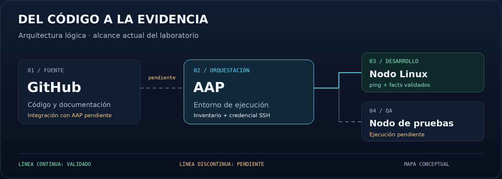

# Infraestructura del laboratorio

[← Volver al portafolio](../README.md)

El laboratorio permite aprender automatización de Linux mediante una plataforma centralizada, inventarios, credenciales y entornos de ejecución. Esta documentación usa nombres funcionales y omite datos de la infraestructura real.

## Componentes

| Componente | Función | Estado documentado |
|---|---|---|
| Proxmox VE | Alojar las máquinas virtuales | En uso en el laboratorio |
| Servidor AAP | Ejecutar los componentes de la plataforma | Instalación finalizada sin errores |
| Automation Controller | Administrar y lanzar automatizaciones | Ping y setup ejecutados satisfactoriamente |
| Entorno de ejecución | Contener Ansible y sus dependencias | Validado para las pruebas realizadas |
| Nodo de desarrollo | Primer destino Linux administrado | SSH, ping y recopilación de facts validados |
| Nodo de pruebas | Destino para una validación posterior | Registrado en inventario; ejecución pendiente |
| Repositorio GitHub | Versionar documentación y futuros playbooks | Creado; sincronización con AAP pendiente |

## Flujo previsto

El repositorio contendrá los playbooks por proyecto. Un Project de AAP sincronizará el código; un Job Template seleccionará playbook, inventario, credencial y entorno de ejecución.

**Ese flujo de Git a AAP aún no está implementado.** Las ejecuciones comprobadas hasta ahora fueron comandos Ad Hoc sobre el nodo de desarrollo.

## Decisiones de aprendizaje

- Un monorepositorio reúne todos los proyectos y su documentación.
- Los grupos distinguen desarrollo y pruebas.
- Una cuenta dedicada permite separar la automatización de las cuentas personales.
- La autenticación por llave se comprobó antes de utilizarla desde AAP.
- Las primeras pruebas se ejecutaron sin solicitar elevación de privilegios.
- La corrección de las opciones de ejecución se incorporó al inventario del instalador.

## Incidencias investigadas

### Resolución y acceso al Gateway

Durante la instalación hubo problemas para obtener la configuración dinámica del proxy. Se compararon resolución local, consultas DNS y acceso HTTPS. El servicio se recuperó tras ajustes y nuevas ejecuciones del instalador.

La secuencia sirve como experiencia de diagnóstico, pero no debe presentarse como una guía universal ni como una causa raíz única totalmente demostrada.

### Modo de red del entorno de ejecución

Podman rechazó el modo `slirp4netns` solicitado por la configuración de Controller. Se verificó que `pasta` podía iniciar un contenedor y alcanzar SSH en el nodo de desarrollo. Tras aplicar el ajuste, el Job `ping` terminó satisfactoriamente.

Ese resultado valida el caso probado; no certifica todas las integraciones o rutas de red.

## Limitaciones abiertas

El laboratorio no tiene alta disponibilidad. La segmentación de red, los permisos detallados, el certificado HTTPS confiable, los respaldos y las pruebas de recuperación requieren trabajo adicional.

El DNS configurado para contenedores con red del host necesita evaluación al introducir otros modos de red. Un acceso satisfactorio por IP no demuestra resolución DNS correcta en todos los entornos.

Tener registrado un host de QA no significa que sus credenciales o automatizaciones ya estén probadas.

## Reproducibilidad

Las futuras instrucciones deberán declarar versiones, requisitos y resultados esperados. No se publican instaladores ni imágenes de productos comerciales; cada persona debe obtenerlos mediante los canales autorizados correspondientes.

[Documentación oficial de AAP 2.7](https://docs.redhat.com/en/documentation/red_hat_ansible_automation_platform/2.7) · [Proyecto 001](../02-proyectos/proyecto-001-descubrimiento-linux/README.md)
