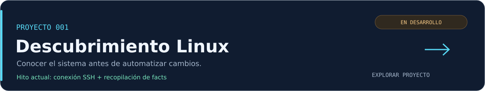
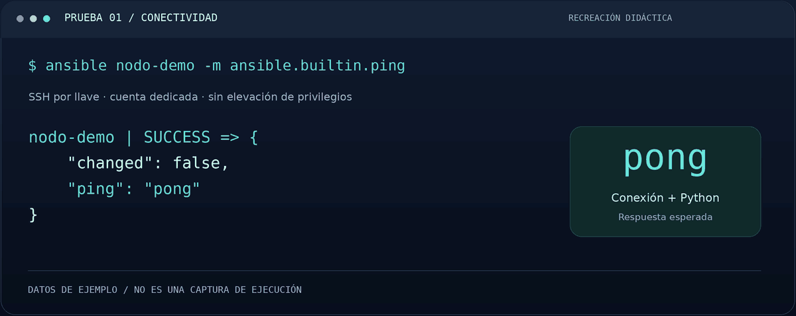

# Proyecto 001 · Descubrimiento de infraestructura Linux

[← Índice de proyectos](../README.md) · [Portafolio](../../README.md)

> **Estado: en desarrollo.** La conexión y la recopilación de información se validaron mediante comandos Ad Hoc sobre un nodo de desarrollo. El playbook reutilizable, el reporte estructurado y la validación en QA están pendientes.

## Problema

Recopilar información de infraestructura con comandos independientes dificulta comparar servidores y repetir el procedimiento. Este proyecto investiga cómo obtener datos con Ansible y presentarlos con nombres, unidades y criterios consistentes.

## Objetivo

Identificar distribución y versión del sistema, CPU lógicas, memoria utilizable y capacidad del filesystem raíz. El resultado previsto es un playbook versionado que genere un resumen comprensible y permita verificar los datos recopilados.

## Alcance actual

Se trabajó sobre un nodo Linux de desarrollo utilizando una cuenta dedicada y autenticación SSH con llave. Las pruebas de descubrimiento se ejecutaron sin solicitar elevación de privilegios.

El segundo ambiente ya está representado en el inventario, pero no se declara validado. Este proyecto aún no ofrece un procedimiento completo de despliegue ni automatizaciones de modificación de sistemas.

## Preguntas de investigación

- ¿Qué demuestra `ansible.builtin.ping` que una prueba de red por sí sola no demuestra?
- ¿Qué información obtiene `ansible.builtin.setup` y cómo debe interpretarse?
- ¿Qué diferencias existen entre recursos provisionados y recursos observados dentro de Linux?
- ¿Cómo conservar únicamente los datos necesarios para un reporte público?
- ¿Qué comprobaciones necesita un playbook para producir resultados consistentes?

## Actividades realizadas

| Actividad | Resultado | Límite de la evidencia |
|---|---|---|
| Preparación del inventario | Hosts y grupos registrados | Registrar no equivale a validar acceso |
| Autenticación por llave | Acceso remoto satisfactorio | Comprobado en desarrollo |
| Ping desde AAP | Respuesta `pong` | Valida conexión y ejecución del módulo |
| Recopilación con setup | Ejecución satisfactoria | Observación de un nodo en ese momento |
| Interpretación de facts | Datos de SO, CPU, memoria y filesystem identificados | Normalización y reporte aún pendientes |

Las evidencias originales se revisaron durante la práctica. **La exportación y anonimización de esos registros para este repositorio está pendiente.**

## Demostración visual

*Recreación didáctica con datos de ejemplo. No es una captura original ni una ejecución nueva.*

El nombre `nodo-demo` es ficticio. Si se necesita una dirección en ejemplos futuros, se utilizará una dirección reservada para documentación, como `192.0.2.10`.

## Datos que contendrá el reporte

| Dato | Referencia de Ansible | Criterio de interpretación |
|---|---|---|
| Distribución | `ansible_distribution` | Identificación del sistema |
| Versión | `ansible_distribution_version` | Versión observada en el destino |
| CPU lógicas | `ansible_processor_vcpus` | No implica núcleos físicos exclusivos |
| Memoria | `ansible_memtotal_mb` | Memoria utilizable informada por Linux |
| Filesystem raíz | Entrada `mount: /` de `ansible_mounts` | Capacidad del filesystem, no del disco completo |

Los nombres aparecen así en la salida Ad Hoc consultada. Al escribir el playbook se verificará cómo acceder a los valores mediante `ansible_facts`.

## Criterios de aceptación pendientes

- El playbook obtiene los datos necesarios en desarrollo y QA.
- Los campos obligatorios se validan y los ausentes se explican.
- Las unidades y conversiones se documentan.
- El reporte distingue hechos recopilados de conclusiones.
- Una ejecución fallida identifica el host y la fase afectada.
- El repositorio no incorpora secretos ni identificadores internos.
- AAP sincroniza y ejecuta una revisión concreta del código Git.

## Pruebas y recuperación

Para el descubrimiento no se introducen cambios intencionales de configuración. Por ello no se define un rollback artificial: se documentarán los errores de acceso o recopilación y el procedimiento para repetir la consulta.

`changed: false` describe el resultado informado por los módulos en esas ejecuciones. No sustituye una prueba de idempotencia para un playbook que todavía no se ha desarrollado.

## Próxima actividad

Escribir el primer playbook de descubrimiento, explicando cada tarea y su finalidad. Después se añadirá la presentación estructurada del resultado y se conectará el repositorio con AAP.

## Referencias

- [Ansible: ping](https://docs.ansible.com/ansible/latest/collections/ansible/builtin/ping_module.html).
- [Ansible: setup](https://docs.ansible.com/ansible/latest/collections/ansible/builtin/setup_module.html).
- [Documentación de AAP 2.7](https://docs.redhat.com/en/documentation/red_hat_ansible_automation_platform/2.7).

[Metodología del laboratorio →](../../00-metodologia/README.md)
