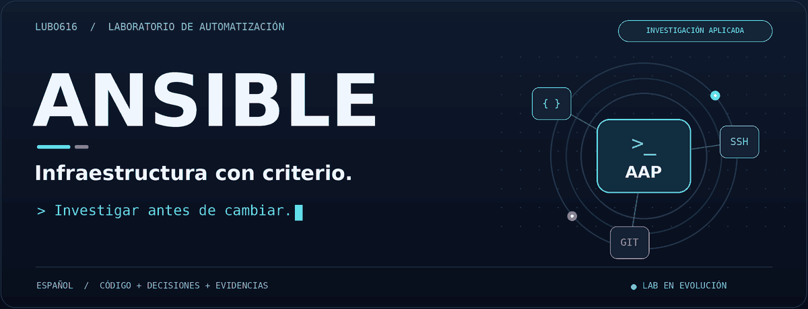
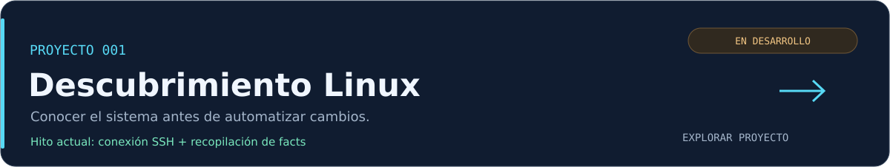
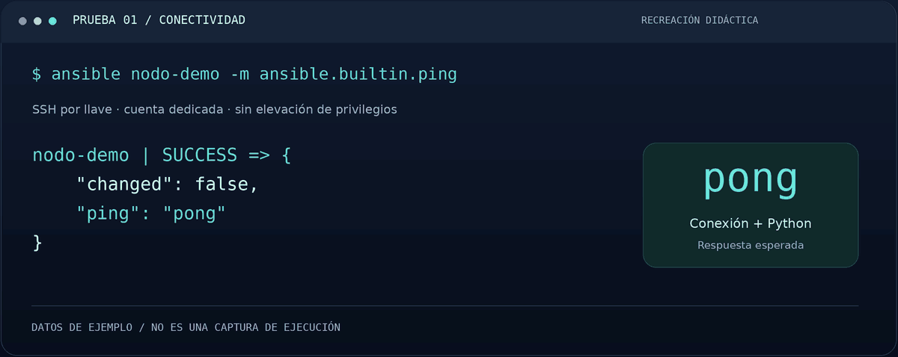
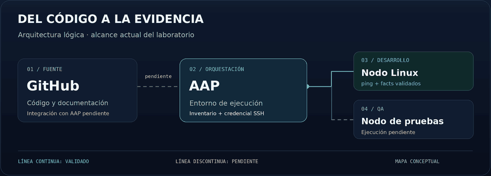

[Versión sin animación](README-sin-animacion.md) · [Proyecto actual](02-proyectos/proyecto-001-descubrimiento-linux/README.md) · [Metodología](00-metodologia/README.md) · [Laboratorio](01-infraestructura-laboratorio/README.md)

# ANSIBLE · Laboratorio de automatización

**Investigar. Automatizar. Validar. Documentar.**

Soy **LUBO616**. Este repositorio reúne mi aprendizaje práctico con Ansible y Red Hat Ansible Automation Platform. Desarrollo proyectos de infraestructura para entender cómo funcionan las herramientas, resolver problemas y explicar las decisiones que tomo durante el proceso.

Mi objetivo es construir una forma de trabajo reproducible: partir de un requerimiento, delimitar el alcance, implementar una solución y comprobar su resultado.

**Estado del portafolio:** en desarrollo. Un proyecto activo; los siguientes están planificados.

## Empieza por aquí

| Si quieres conocer… | Explora |
|---|---|
| Qué estoy construyendo y qué he comprobado | [Proyecto 001 — Descubrimiento Linux](02-proyectos/proyecto-001-descubrimiento-linux/README.md) |
| Cómo preparo, ejecuto y documento una práctica | [Metodología de trabajo](00-metodologia/README.md) |
| Cómo se relacionan los componentes | [Arquitectura del laboratorio](01-infraestructura-laboratorio/README.md) |
| Qué proyectos vienen después | [Índice y ruta de aprendizaje](02-proyectos/README.md) |

## Proyecto destacado · Descubrimiento Linux

**El problema:** recopilar información de servidores con comandos independientes produce resultados difíciles de comparar y repetir.

**La investigación:** utilizar Ansible para identificar sistema operativo, procesadores, memoria y sistemas de archivos, y convertir esos datos en un resumen consistente.

**El avance:** validé la conexión a un nodo de desarrollo y la recopilación de información mediante comandos Ad Hoc. Estoy preparando el paso hacia un playbook versionado y un reporte estructurado.

[Consultar alcance, resultados y siguientes entregables →](02-proyectos/proyecto-001-descubrimiento-linux/README.md)

### Una muestra del flujo

*Recreación didáctica con datos de ejemplo. No es una grabación del laboratorio ni sustituye las evidencias de ejecución.*

## Qué ya está validado

- **Plataforma:** instalación de AAP 2.7 completada con `failed=0` en el resumen final del instalador.
- **Organización:** inventario con grupos de desarrollo y pruebas, y hosts registrados.
- **Acceso:** autenticación SSH mediante llave hacia un nodo de desarrollo con una cuenta dedicada.
- **Ejecución:** respuesta `pong` del módulo `ansible.builtin.ping` desde Automation Controller.
- **Descubrimiento:** ejecución satisfactoria de `ansible.builtin.setup` e interpretación de facts de sistema, CPU, memoria y almacenamiento.
- **Resolución de problemas:** diagnóstico de una incompatibilidad de red entre la configuración de ejecución y Podman; ajuste persistente y validación con un Job posterior.

La primera ejecución en QA, el playbook reutilizable, el reporte y la integración Git→AAP están pendientes. Las evidencias originales deben revisarse y anonimizarse antes de incorporarse al repositorio.

<strong>Cómo interpreto los resultados</strong>

`ansible.builtin.ping` comprueba el acceso y la ejecución de Python remoto; no es un ping ICMP. Una respuesta satisfactoria no demuestra que todas las automatizaciones futuras funcionen.

`changed: false` indica que el módulo no reportó cambios en esa ejecución. La idempotencia de un playbook requiere pruebas específicas.

Los facts son una observación del sistema en un momento concreto. La memoria utilizable dentro de una VM y la capacidad de su filesystem no equivalen necesariamente a los recursos provisionados en el hipervisor.

## Cómo trabajo

| Etapa | Pregunta que debe responder |
|---|---|
| Investigación | ¿Qué problema existe y qué documentación lo explica? |
| Diseño | ¿Qué voy a automatizar y cuál es su alcance? |
| Comprobaciones previas | ¿Se cumplen las condiciones para ejecutar? |
| Implementación | ¿Qué hace cada tarea y por qué? |
| Validación | ¿El resultado cumple los criterios definidos? |
| Documentación | ¿Otra persona puede comprenderlo y reproducirlo? |
| Mejora | ¿Qué limitaciones, errores y decisiones debo registrar? |

Para cambios de configuración, incorporo un procedimiento de recuperación. Cuando corresponda, pruebo repetición, fallos y reversión.

## Laboratorio en una mirada

*Diagrama conceptual. Ejecución en desarrollo validada; integración con Git y ejecución en QA pendientes.*

Utilizo virtualización con Proxmox VE, servidores Linux, AAP, contenedores Podman y SSH. La documentación pública describe funciones y relaciones, sin exponer el direccionamiento real. Es un laboratorio sin alta disponibilidad; su configuración no representa una arquitectura de producción terminada.

[Leer las decisiones y limitaciones del laboratorio →](01-infraestructura-laboratorio/README.md)

## Ruta de proyectos

| Proyecto | Estado | Próximo resultado esperado |
|---|---|---|
| **001 · Descubrimiento Linux** | En desarrollo | Playbook y reporte de inventario |
| 002 · Configuración base | Planificado | Definir y comprobar un estado deseado |
| 003 · Gestión de parches | Planificado | Actualización con validaciones y recuperación |
| 004 · Detección de cambios | Planificado | Comparar configuración real y esperada |
| 005 · Despliegue web | Planificado | Servicio desplegado y validado |
| 006 · Recuperación de cambios | Planificado | Procedimientos probados de recuperación |

## Publicación y aprendizaje

El código de ejemplo, las explicaciones y las evidencias públicas deben poder entenderse sin acceder a la infraestructura real. Uso nombres ficticios y reviso cada publicación para excluir secretos, datos de clientes y configuraciones internas.

Los recursos visuales están incluidos en el repositorio. Las animaciones son ilustrativas; los estados de avance se mantienen manualmente y no representan resultados de CI.

[Diseño y mantenimiento del README](docs/guia-del-diseno.md) · [Perfil de LUBO616](https://github.com/LUBO616)

**Aquí aprendemos y jugamos; después validamos y documentamos.**
